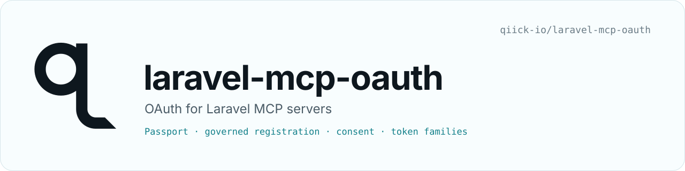

<p align="center">
  <picture>
    <source media="(prefers-color-scheme: dark)" srcset=".github/assets/header-dark.svg">
    <source media="(prefers-color-scheme: light)" srcset=".github/assets/header-light.svg">
    
  </picture>
</p>

# qiick/laravel-mcp-oauth

> **In development. Not released and not on Packagist yet: do not depend on it.**

OAuth authorization server for `laravel/mcp` endpoints in qiick Laravel
products. Consent plumbing, governed dynamic client registration, redirect URI
rules, refresh-token family revocation, RFC 6750 errors, fail-closed Passport
keys, and the `/mcp` Bearer door — built on Passport and `laravel/mcp`.

Part of the qiick fleet. Binding design:
`projects/qiick/packages/laravel-mcp-oauth-design.md` in the knowledge base
(answers: `decisions/2026-11-22-mcp-oauth-and-access-design-answers.md`).

## Status

Pre-`0.1.0`. Public APIs may change in any 0.x release; see [UPGRADING.md](./UPGRADING.md).
Do not require this package from production apps until a tagged release lands on
Packagist (Packagist publish only after Luca’s go). `1.0.0` needs a non-externa
adopter and Luca’s go.

## Requirements

- PHP `^8.3` with `ext-intl` and `ext-openssl`
- illuminate/console, contracts, database, http, routing, support
  `^12.41.1 \|\| ^13.0` (never `laravel/framework`)
- `laravel/passport ^13.12`, `laravel/mcp ^1.2`, `league/uri ^7.8`
- Optional: `inertiajs/inertia-laravel ^3.0` (default `ConsentView`)

## Install (when published)

```bash
composer require qiick/laravel-mcp-oauth:^0.1
php artisan vendor:publish --tag=mcp-oauth-config
php artisan vendor:publish --tag=passport-migrations
php artisan vendor:publish --tag=mcp-oauth-migrations
php artisan vendor:publish --tag=mcp-oauth-binding-stub
php artisan passport:keys
```

The service provider is auto-discovered. Products implement the contracts
(`AdminSwitch`, `GrantStore`, `ConsentProvider`, …), call
`McpOAuthRoutes::register()` from their MCP routes file, and keep OAuth off
until keys exist and the admin switch is flipped.

## Threat model (short)

| Threat | Mitigation |
| --- | --- |
| Public DCR flood / phishing | Off by default (three gates); per-key and global caps; prune; admin block |
| Hostile redirect hosts | League URI only; ASCII hosts; UTS #46; exact/subdomain block |
| Host-header discovery poisoning | Issuer and resource from `APP_URL` only |
| Refresh-token theft / races | Atomic rotation; family + grant revocation; live binding required |
| Missing Passport keys | 503 `temporarily_unavailable`; switch refuses to turn on |

Full table: design §16.

## Public API (contracts and data)

Products implement `Qiick\McpOAuth\Contracts\*` (`AdminSwitch`, `GrantStore`,
`ConsentProvider`, `GrantAuthorizer`, `ApiKeyDoor`, `McpCredentialBinder`,
`AuditLogger`, `ConsentView`, `OAuthUserResolver`). Wire and consent shapes are
the `@api` DTOs under `Qiick\McpOAuth\Data` and events under
`Qiick\McpOAuth\Events`. Public ids are UUID strings only.

## Config

Publishable `config/mcp-oauth.php` (tag `mcp-oauth-config`). Env prefix
`MCP_OAUTH_*`. Redirect allowlists stay in `laravel/mcp`’s `mcp.redirect_domains`
and `mcp.custom_schemes`. Issuer is always `APP_URL`.

## Testing

```bash
composer test
composer lint
composer analyse
bash scripts/mutate-per-class.sh   # per-class MSI ≥ 95 once targets land
```

CI: PHP 8.3/8.4/8.5 × Laravel 12/13 × lowest/stable, Pint, PHPStan max, Pest,
`composer validate --strict`, `composer audit`, database engine jobs, real HTTP
(`php -S`) once the `http` group exists, and qiick standards drift against
app-ui `v0.12.0`.

## License

[MIT](./LICENSE)
